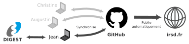

## Principe général

- Site internet à base de fichiers *simples*.
- Idéalement, vous **ajoutez/modifiez du contenu** sans trop réfléchir à la forme.

. . .


Par exemple, vous pouvez:

- Ajouter du texte
- Ajouter des images
- Modifier des informations (email, publications)

## Principe général



- Site hébergé sur GitHub.
    - Publié automatiquement à chaque changement.
- Chacun *pourrait* avoir une copie locale.

. . .

Pour le moment :

- Une copie **sur DIGEST**
- Jean envoie les changements sur GitHub

## Site bilingue

Chaque page associée à deux fichiers :

- `page.md` version française
- `page.en.md` version anglaise

. . .

> Si vous ne voulez pas écrire les deux versions, c'est facile de donner un fichier à une IA ([chat.inserm](https://chat.inserm.fr/)) et demander de le traduire. 

## Organisation des fichiers

```
├── content
│   ├── eq1.en.md
│   ├── eq1.md
│   ├── ...
│   ├── people
│   │   ├── agnes.wiedemann.en.md
│   │   ├── agnes.wiedemann.md
│   │   ├── ...
├── static
│   ├── images
│   │   ├── eq1
│   │   │   ├── banner.jpg
│   │   │   └── logo.svg
│   │   ├── people
│   │   │   ├── agnes.wiedemann.png
│   │   │   ├── ...
│   └── ...
└── ...
```


## Quels fichiers modifier ?

- Page d'une équipe ou d'une plateforme.
    - `content/eq1.md` (version française)
    - `content/eq1.en.md` (version anglaise)
- Page d'un membre.
    - `content/people/prenom.nom.md` (version française)
    - `content/people/prenom.nom.en.md` (version anglaise)
- Photo d'un membre.
    - `static/images/people/leon.kautz.png`
- Photo *bannière* en haut de la page d'équipe
    - `static/images/eq1/banner.jpg`
- "Logo" utilisé dans les pages [Équipes](https://www.irsd.fr/equipes/) ou [Plateformes](https://www.irsd.fr/platforms/)
    - `static/images/eq1/logo.svg`

## Syntaxe Markdown pour le contenu

- **Syntaxe simple** pour la mise en forme (titre, listes, gras/italiques, etc).
- Chaque fichier contient un **en-tête** avec des métadonnées.

```md
---
title: "Le titre de la page"
image: images/une_image.jpg
---

Contenu de la page écrit en Markdown.

# Un titre de niveau 1

## Un titre de niveau 2

Une phrase avec des mots **en gras** et *en italique*.
Une liste non numérotée avec : 

- un élément
- un autre élément
    - un sous-élément
    - un autre sous-élément

On peut aussi écrire des liens comme ça : [texte à afficher](https://www.url.du.lien.fr).
...
```

## Comment modifier un fichier markdown ?

- **Pas avec Word !!!**
- Conseil : éditeur en ligne : [https://markdownviewer.org/](https://markdownviewer.org/).

. . .

1. Importer un fichier avec *Import Markdown*
2. Modifier le contenu dans l'onglet de gauche
3. Exporter le fichier avec *Export*
4. Remplacer le fichier original

## Plus d'informations

- [Documentation](https://github.com/irsd-tls/irsd-tls.github.io/blob/main/DOCUMENTATION.md)
- [Tutoriel sur la syntaxe de Markdown](https://docs.forge.apps.education.fr/modeles/tutoriels/tutomd/)
- [Outil d'édition markdown en ligne MarkdownViewer](https://markdownviewer.org/)
- Templates à partager avec les membres de vos équipes: [en français](https://markdownviewer.org/#share=eJx1VNtu20YQfedXDJSHtIIpS7Jl2UbRtHXyECAJXCdu8xasyLE0BXeX3ovrIsi_9FXfoR_rGVKy5dY1IJO7nNk5c-acLcuySJIaPqfBZdisnbf0wdtBwdZIg802MPZG-P0kLnKwo5swKP7kRZSkSauU2nh-eNhyiN6ZZoRPrVny4aBYSlrlBWL6ly8Z6c5YHhQ-VFLjwxh_JX7T8mx-NC9ns8nJoGhX3unJ4xmdTGl-TMczOhoPiuC9xfYvs-kUQR71xTtsXKw4VCvOgBW54Spx_aX2Es-pICppMBmPJuOj08N4PJmdnpTj6VE5np2enZT3g8eAyfTkMFbCruKRWSxPT-eTQVGCnOLFC3ovTsqL34qipOFwcnZ2Vk7H48lwSO-kYpBC7Ojz58-0-Zs--dx4NDrqYjVMY48R-97ExIFq3oXi8RB1rFFzRL32VfLBJA1oXl47uQOvkjbrbeIB1cZFapjqzbo1IbFll7YfR3QZ_B-czp-cfbo7-9oxGec2a9b4arOOOTC1PgfarBu-69BF3Wg4PqTPkT7R9EsfU72D16N4uVnfZmn5-a4m8xJpFysTlj3-K676WdHbDx_fXL3vm3x79fH1qOP5zT1UlASEHtInxDq5zRyV9ovcJAWruLlpFCAwt9AVkIvRpbjEMYnTxV7GwlRgL2CyjrF9e3lxhcfvrMNwtGh8wvLnKsldx3IbPB6--Stp7Q5Vz-l38XutHnYtFMU7H9iStDFbqn3jA2FQBH2nA6o8ZAElAgKoMLW0AnW5JXEjaTg8oMg1koglR-trwhhbHCAOvpA6Y6I5UWMWKEGc-uOZhtYsnSHTAJsZjorrBOWJJVOTFX25w9LYA8JQIjnMK-Sa-B6AJRm1C-WmMbby_dkaJFG0VnemtAgmNoBvgcr3baBWGhWv9UiTE5OEbhJdx-LACK6IFbuaA9rHxp1vcotyDDjoljhioJVganbXCGe6yUuBjpwCIggZixxGxZv7itsEM4NMsOCrynCFuCq3UpukGegCU5IaugePyhWKVrlpjfZN_uZGKjEqZQ761fpGYRglSEBH3DKbLVT3EXNA-3p7tZoG9VFGL5iatyCHBEKBih3gReIQtmN-aBLsV1WOxiV56M9COqiR6373gJJPxpLKxaBSNyI2GgT1KGoDYy4IFHn0giEmJelOCe0AQQGIwaAMlIdrFx6kBYMNBIn-r6VKpueC79tGKvQ3Kj6w9b1AtIzdxwyizG4de93GVm9nFSymTL7WPbzonFKv1y5pKwmUQqTqUbZNA6aP3QRCJzXer6cpQo5hAmQqNO0ekg--EyvaszqZTro7Frfe6sr-22DD4Z7F1FA7j_Wi2wOsenHZ9hVgN-ihlq3hTO-4__NbZze79Zvt5qR332Nf_7Wgec6D9okH0VjnQlAZ2s6EMQM4LrOtK33U_KfOrJ84Ux6dmcOr4tedN_UGaOAuUKcefWpNZRZOYfO8Q7sWnaykUcfoVQph7ZU56M7ubbw_JK22NfNt9o-ieursV_1VmhcqTmUB1_rXrz_AeL5tuGz3PtCP374VRfEPPo3_7g) ou [en anglais](https://markdownviewer.org/#share=eJx1VF1vGzcQfL9fsVDeBJ8syZZlG0VT5KNFACdw7aT1W0Dx1ta2R_LMD8dGkP-e2TvJlttEgKQ7cpe7MzvDuq6rLLnlUxr9LjFlbxzTmRkeRhU7Iy32usg-uAm-v4lPHN3kOo6qL7xKkjV3nXOXTvf3O44peNNOsNWZG94fVTeS12WFmOHhc0H6cHiIVhpsTPGp8Z3XJ8uDZb1YzI5GVbcOXk-eLuhoTstDOlzQwXRUxRAcll8t5nMEBdSX4LFwwYlNtGtGX4lbtpmbz02QdEoVUU2j2XQymx4c76fD2eL4qJ7OD-rp4vjkqL4fPQXM5kf7yQp7yxOzujk-Xs5GVQ2Sqhcv6HIdYqbXf1VVTePx7OTkpJ5Pp7PxmM7EMmgh8XR1daV_H0NpA6BO-lgN09hDxL4HuRy3oSZTXjN98nIH6iQ_ULjWjce8Q81bIu98_ean0Xt6nO7okQ13JmbHPk_oPIZ_QMXpsyOPt0f-YTp6AGuUA0UjAGDXYv9l_xi6ROisrx5SboLNIZqWrrltw5fdmh_ZOO1up8xsWWsetGI8eqGnAdG7D5dvL95r_LuLyzeTnty399BO1h72cZpde7ktnJTqdz5zygJVEXfQELeCR4seyJY2l8gIemUw8NhvPK7dnr--wN_frIR7WrUh4xWUZA7tQxZLSJI70Nh30Ddo19QNnKH2WYjsSLpUHDWhDZHAOUG7eY9swMBRE7UA1zTSCYTjbwjt5fF4jxI3SCKWklxoKLPrgo4dmpemgJCSqTUrlCDOw_FMY2duvCHTAr0ZT6pPmdgLqG3IiT7c4dW4PbotkshjKLE0xPcMK2WjVqDStsbZMJytQZJEa_VnSodgYoP2HboKAwzUypPqjR5pSoaMIwjcIMaQI8P-a_YNCM66cBfa0qEcox2gJU4qHWnbLU-AVOi63AhG7LUhgiTxUuKkentvuctclEywEKw1bBFnSyeNyZoBFBiCNJANeFSuUBRz7YzihuavxYqB0HGV6K4LrbZhlCABHWnDbHHQ1iXmAPh6M3WaBo1RARZMLTiQQwJ5QKke7SXiGDdjfgQJ9q0tyfgsj_gcxIkapRlW9-CgDAeoXEynOsQSGw2CerRrw2RWBIoCsGCIWUm6U0L7hqAAxGBQ6hBcqTAarRhsIEj0txGbzcAF33etWOCbVB_YhUEgWsbt9gyizPY9DbpNnd68KlhMmUKja3jQOeVBr33SRhIohUjVo2xAo82Q-gnEXmq8W09ThDzDBMjU1hQ9JB9DL1bAczqZXrpbFjfe6sv-12Dj8Y7F1FBbjw2i22lY9eKLGyrAbtBDIxvDmcFxP_Nbbze38Zvr5wRsO7j-b0HzIw-6Zx4EsN6FoDJ2vQlTQeO4vDauDEnznzuzeeZMeXJmiS-rP7fe1BsA9yAKinr0uTWVWTiFzY8d2kP0spZWHaN3KoS1U2avP3uw8e6QtNrGzLclPInqubNf9pfoeVmpOJUFXKBfv_4C44Wu5brb2aBfv32rquo7PerrJg)
